<picture><source media="(prefers-color-scheme: dark)" srcset="assets/hero-dark.svg"></picture>

<picture><source media="(prefers-color-scheme: dark)" srcset="assets/about-dark.svg"></picture>

<a href="https://github.com/Ikhlasulov/namaz"><picture><source media="(prefers-color-scheme: dark)" srcset="assets/project-namaz-dark.svg"></picture></a>&nbsp;<a href="https://github.com/Ikhlasulov/openrpm"><picture><source media="(prefers-color-scheme: dark)" srcset="assets/project-openrpm-dark.svg"></picture></a>

<a href="https://github.com/Ikhlasulov/open-rpm-web"><picture><source media="(prefers-color-scheme: dark)" srcset="assets/project-open-rpm-web-dark.svg"></picture></a>&nbsp;<a href="https://github.com/Ikhlasulov/predely"><picture><source media="(prefers-color-scheme: dark)" srcset="assets/project-predely-dark.svg"></picture></a>

<picture><source media="(prefers-color-scheme: dark)" srcset="assets/stack-dark.svg"></picture>

<picture><source media="(prefers-color-scheme: dark)" srcset="assets/stats-dark.svg"></picture>

<picture><source media="(prefers-color-scheme: dark)" srcset="assets/wave-dark.svg"></picture>

<a href="https://ikhlasulov.github.io/"><picture><source media="(prefers-color-scheme: dark)" srcset="assets/button-1-dark.svg"></picture></a>&nbsp;&nbsp;<a href="https://github.com/ikhlasulov?tab=repositories"><picture><source media="(prefers-color-scheme: dark)" srcset="assets/button-2-dark.svg"></picture></a>

<a href="https://metawka.github.io/expressive-profile/?from=ikhlasulov"><picture><source media="(prefers-color-scheme: dark)" srcset="assets/credit-dark.svg"></picture></a>

