<picture><source media="(prefers-color-scheme: dark)" srcset="assets/hero-dark-v2-988eb85a.svg"></picture>

<picture><source media="(prefers-color-scheme: dark)" srcset="assets/about-dark-a1e6515d.svg"></picture>

<a href="https://github.com/ikhlasulov/namaz"><picture><source media="(prefers-color-scheme: dark)" srcset="assets/project-namaz-dark-009f6665.svg"></picture></a>&nbsp;<a href="https://github.com/ikhlasulov/islamic-library"><picture><source media="(prefers-color-scheme: dark)" srcset="assets/project-islamic-library-dark-04010850.svg"></picture></a>

<a href="https://github.com/ikhlasulov/predely"><picture><source media="(prefers-color-scheme: dark)" srcset="assets/project-predely-dark-abe5aa03.svg"></picture></a>&nbsp;<a href="https://github.com/ikhlasulov/openrpm-web"><picture><source media="(prefers-color-scheme: dark)" srcset="assets/project-openrpm-web-dark-8cb688f4.svg"></picture></a>

<picture><source media="(prefers-color-scheme: dark)" srcset="assets/stack-dark-680d2f0c.svg"></picture>

<picture><source media="(prefers-color-scheme: dark)" srcset="assets/stats-dark-927775e1.svg"></picture>

<picture><source media="(prefers-color-scheme: dark)" srcset="assets/wave-dark-1e69500f.svg"></picture>

<a href="https://ikhlasulov.github.io/"><picture><source media="(prefers-color-scheme: dark)" srcset="assets/button-1-dark-3efebe3c.svg"></picture></a>&nbsp;&nbsp;<a href="https://github.com/ikhlasulov?tab=repositories"><picture><source media="(prefers-color-scheme: dark)" srcset="assets/button-2-dark-7950d100.svg"></picture></a>

<a href="https://metawka.github.io/expressive-profile/?from=ikhlasulov"><picture><source media="(prefers-color-scheme: dark)" srcset="assets/credit-dark-e0340796.svg"></picture></a>

